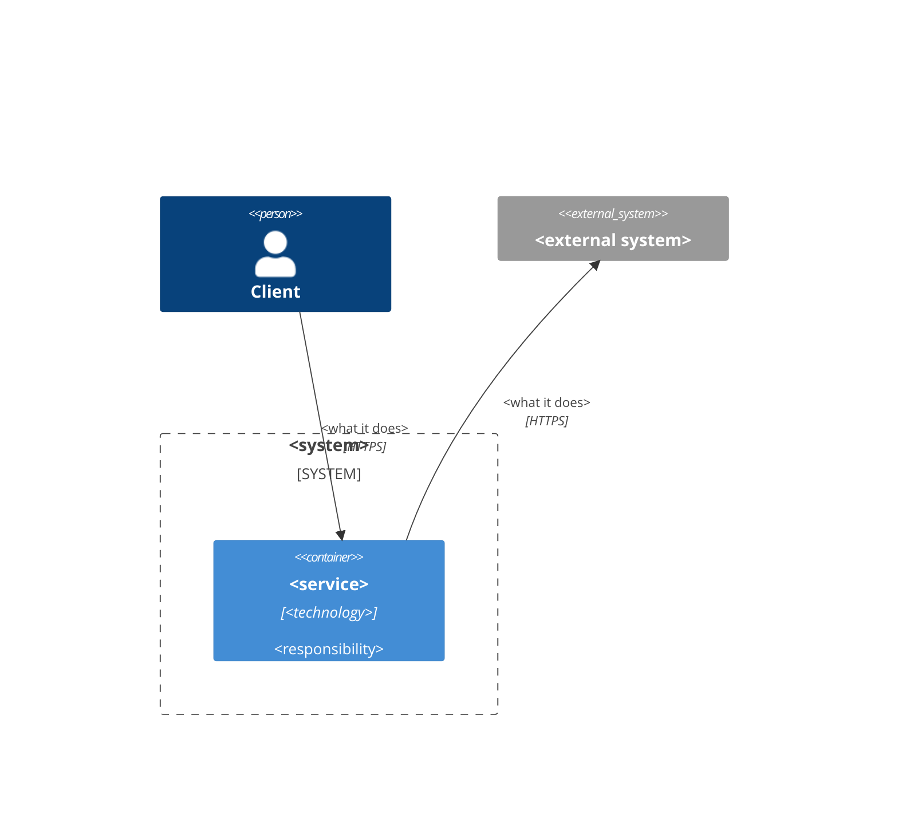

# Architecture: <feature title>

**Depends on:** <full keys of the features whose architecture this one relies on, with the decisions in parentheses: `FTR.FMS.CAR-0001` (A3)>

The gate is needed if service boundaries, contracts between services, data storage or the rollout order change. Otherwise the writer proposes to skip it (`FTR.HMR.DEV-0001` R6).

## Affected services and contracts

The first column is the key of a service of the Hammurapi catalog (`booking`), one row per service: by these keys Hammurapi links the feature to the services, code generation and the check of tests in CI. A key not in the catalog fails the submission. External systems not in the catalog go only to the diagram.

| Service | Role in the feature | Changing contracts (API, events) |
|---|---|---|

## C4 diagram

A diagram of the level of containers in mermaid. Every service of the table above is a `Container` (or `ContainerDb`, `ContainerQueue`) whose identifier is its key with `-` and `.` written as `_` (`hammurapi-core` → `hammurapi_core`). People are `Person`, external systems `System_Ext`, relations `Rel(from, to, "what", "protocol")`.

## Components

Name services, endpoints, events and tables literally: the search finds the specification by these words.

## Data flows

## Integrations

## Security

## Observability and operations

## Rollout order

Dependencies between the changes of services: what is rolled out first, compatibility of contracts.

## Changes to other features

The section is needed when the architecture of the feature changes architecture decisions of other features of the default branch; otherwise delete it. One row is one decision: the full key of the feature, `A<n>` or «whole feature», what changed in one phrase; a cancelled decision — «the decision no longer applies». Architecture changes only architecture: a change of behaviour goes to the section of `product` of the same feature. A feature still in work is changed by an assignment in its own thread, not here. Hammurapi puts the notes «*A<n> — changed in `<key of this feature>` A<m>: …*» under the table of decisions of the changed feature on save. Example keys go into the text, not into rows: every row of the table is applied.

| Feature | Decision | What changed |
|---|---|---|

## Decisions

Every decision has a number `A<n>` (globally `<feature ID>-A<n>`, for example `FTR.FMS.CAR-0005-A3`): other features refer to the decision by it. A number is never reused: a cancelled decision stays with a note; a decision inserted later gets a letter (`A3a`).

| A | Decision | Reason |
|---|---|---|
