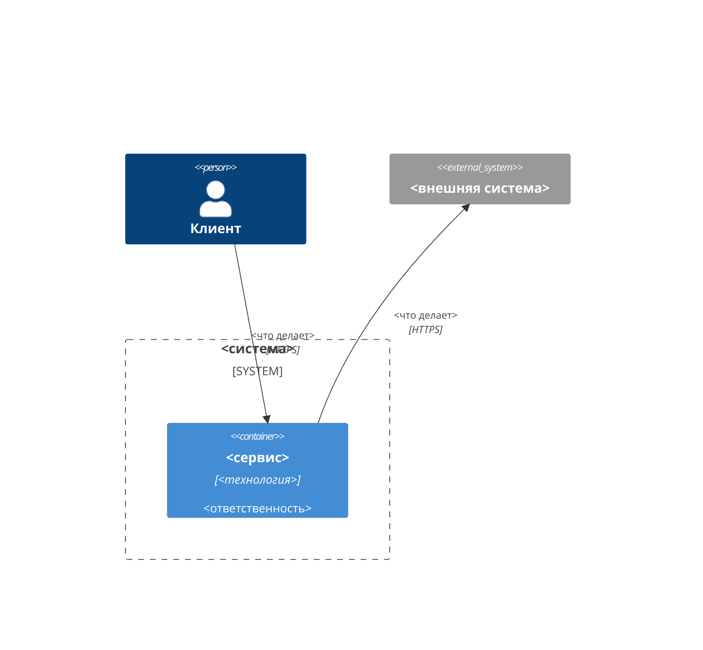

# Архитектура: <название фичи>

**Опирается на:** <полные ключи решений, на архитектуру которых опирается фича, с номерами архитектурных решений в скобках: `FTR.FMS.CAR-0001` (A3)>

Гейт нужен, если меняются границы сервисов, контракты между ними, хранение данных или порядок выката. Иначе писатель предлагает его пропустить (`FTR.HMR.DEV-0001` R6).

## Затрагиваемые сервисы и контракты

Первая колонка — ключ сервиса из каталога Hammurapi (`booking`), по строке на сервис: по этим ключам Hammurapi связывает фичу с сервисами, генерацией кода и проверкой тестов в CI. Ключ не из каталога — ошибка при сдаче. Внешние системы, которых нет в каталоге, — только на схеме.

| Сервис | Роль в фиче | Меняющиеся контракты (API, события) |
|---|---|---|

## Схема C4

Схема уровня контейнеров в mermaid. Каждый сервис таблицы выше — `Container` (или `ContainerDb`, `ContainerQueue`) с идентификатором, равным ключу: `-` и `.` ключа пишутся как `_` (`hammurapi-core` → `hammurapi_core`). Люди — `Person`, внешние системы — `System_Ext`, связи — `Rel(откуда, куда, "что", "протокол")`.

## Компоненты

Сервисы, эндпоинты, события и таблицы называйте дословно: по этим словам спецификацию находит поиск.

## Потоки данных

## Интеграции

## Безопасность

## Наблюдаемость и эксплуатация

## Порядок выката

Зависимости между изменениями сервисов: что выкатывается первым, совместимость контрактов.

## Изменения в других решениях

Раздел нужен, если архитектура фичи меняет принятые архитектурные решения других фич основной ветки; иначе удалите его. Одна строка — одно решение: полный ключ фичи, `A<n>` или «всё решение», что изменилось одной фразой; отменённое решение — «решение больше не действует». Архитектура меняет только архитектуру: изменение поведения — в разделе `product` этой же фичи. Фича, которая ещё в работе, меняется поручением в её собственной теме, а не здесь. Пометки «*A<n> — изменено в `<ключ этой фичи>` A<m>: …*» под таблицей решений изменённой фичи ставит Hammurapi при сохранении. Примеры ключей — в тексте, не строками таблицы: каждая строка таблицы применяется.

| Решение | Архитектурное решение | Что изменилось |
|---|---|---|

## Принятые решения

Каждое решение — с номером `A<n>` (глобально: `<ID фичи>-A<n>`, например `FTR.FMS.CAR-0005-A3`): по нему на решение ссылаются другие фичи. Номер не переиспользуется: отменённое решение остаётся с пометкой; решение, вставленное позже, получает букву (`A3a`).

| A | Решение | Обоснование |
|---|---|---|
